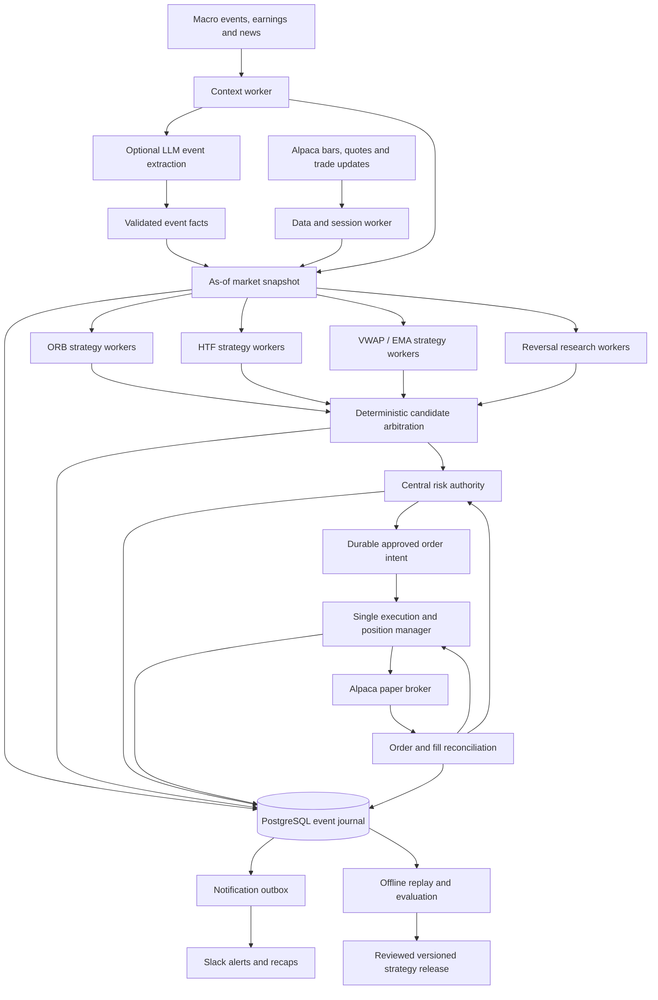

# Automated Trading System - Proposed Architecture

Status: design proposal following the [2026-10-19 audit](TRADING_AUDIT_2026-10-19.md).
It is not implemented or deployed by this review.

For the researched source catalog, all-instrument preparation routine, strategy
experiment queue and real-time promotion gates, see the
[research and deployment plan](TRADING_RESEARCH_AND_REALTIME_PLAN_2026-10-19.md).

## Objective and ownership

Optimize expected net portfolio return subject to explicit drawdown, daily loss,
exposure, data freshness, and liquidity constraints. A valid outcome includes NO_TRADE.
Every submitted order must trace to an immutable setup, a complete policy decision,
and a risk reservation. Only one service owns brokerage order creation and changes.

Specialized workers can improve coverage and reliability. Most should be ordinary
deterministic code. An agent means a component with a narrow input/output contract;
it does not require an LLM, autonomous prompts, or another paid service.

## Component graph



The diagram is a logical ownership structure, not a recommendation to deploy a
separate cloud machine for every box. Research outputs enter production through
reviewed versioned releases; they cannot modify running risk limits or trading code.

## Workers and responsibilities

| Worker / agent | Inputs | Outputs and authority | Implementation |
| --- | --- | --- | --- |
| Session supervisor | Exchange calendar, versioned config, health | Session identity, leadership lease, start/end, entry windows | Deterministic |
| Market data | One multi-symbol stream, REST bootstrap/recovery | Validated bars, quotes, gaps, revisions, shared watermark | Deterministic |
| Context | Scheduled macro releases, issuer earnings, news sources | Timestamped structured event facts and unknown states | Deterministic with optional LLM parsing |
| Strategy workers | Same as-of snapshot, their own setup state | Candidate or explicit WAIT/INVALID/EXPIRED state | Deterministic; partitioned by symbol |
| Candidate selector | Eligible candidates and fixed policy | Ranking, conflict resolution, reasoned rejection | Deterministic first; optional validated ML later |
| Risk authority | Current account, orders, positions, fills, reservations | Atomic approve/reject and bounded reservation | Deterministic; mandatory veto |
| Execution / position manager | Approved intent, fresh quotes, lifecycle policy | Idempotent entry, protection, exit requests | Deterministic; sole broker writer |
| Reconciler / watchdog | Broker updates, local intent ledger, heartbeats | Fill truth, discrepancies, entry lockout, recovery | Deterministic |
| Research / evaluation | Immutable historical events and candidate history | Comparison reports, confidence intervals, proposed versions | Statistical code; optional LLM research help |
| Reporting | Committed events and delivery records | Slack messages and end-of-session reconciliation | Deterministic |

The LLM receives no trading credentials and has no order tool. Structured extraction
must retain source citations, entity matching, publication time, first-seen time, and
uncertainty. Treat article text as data; instructions inside it cannot authorize code
execution, change risk limits, or issue orders.

## Runtime and symbol coverage

Start with one Python service using bounded asynchronous tasks and PostgreSQL.
Use a shared in-process queue for events and a transactional outbox for durable
actions and notifications. Add Redis or a distributed message broker only if measured
load or recovery requirements justify it. Agent count does not imply server count.

Maintain one strategy state machine per `(symbol, strategy_version, session)`.
Use all 20 configured watchlist instruments as the research universe and SPY as an
additional benchmark where needed. Explicit per-strategy symbol eligibility preserves
the current eight-symbol intraday and eighteen-symbol HTF subsets until research
justifies expanding them. Every eligible symbol receives the same defined policy.

Fetch each symbol's bars once, share QQQ/SPY context, and cache previous-session HTF
data once per session. State changes are ordered per symbol, while different symbols
can progress independently. Arbitrating simultaneous candidates must be repeatable
given the same event stream, rather than depending on set order or request timing.

A bar-based strategy can remain based on closed one/three-minute candles while
receiving data through a live stream. Streaming reduces acquisition delay; it does
not by itself create an economic edge. Alpaca recommends streaming for timely data
and documents both original and updated bar events.
[Alpaca stream documentation](https://docs.alpaca.markets/us/docs/real-time-stock-pricing-data).

## Time and data contracts

Every event carries UTC timestamps and an exchange-session ID. Use New York time
only for session policy and presentation. Keep four distinct times where relevant:

1. `event_time`: when the exchange trade/bar/news event occurred.
2. `received_at`: when this system first received the event.
3. `decision_time`: when a candidate or risk decision was made.
4. `fill_time`: when the broker reports execution.

A snapshot includes only inputs that were actually available at its as-of time.
Stock and benchmark features share a cutoff. Bars include interval start/end,
observation count, feed, adjustment policy, revision, and known gaps. A resampled
three-minute bar is eligible only when its policy-defined source observations are
complete and the interval has closed. Sparse-feed behavior must be explicit.

Preserve received versions for replay. Later corrections may update a research view
and create a correction event, but cannot rewrite the past trade decision. Bootstrap
history and live updates need deduplication and a documented correction policy.

News has independent `published_at`, `first_seen_at`, `scheduled_event_time`, and
`expires_at` fields. A macro search window is not a post-event strategy start time.

## Candidate contract

```json
{
  "schema_version": 1,
  "candidate_id": "stable-id",
  "setup_id": "stable-setup-id",
  "run_id": "run-id",
  "session_id": "XNYS:2026-10-19",
  "symbol": "AAPL",
  "strategy_version": "VERSIONED_RULESET",
  "config_hash": "hash",
  "code_sha": "commit",
  "snapshot_id": "snapshot-id",
  "asof_time": "2026-10-19T13:37:00Z",
  "observed_at": "2026-10-19T13:37:01Z",
  "expires_at": "policy-defined-time",
  "direction": "LONG",
  "entry_reference": 100.0,
  "stop_reference": 99.0,
  "target_reference": 102.0,
  "invalidation_policy": "versioned-exit-rule",
  "eligibility_reasons": [],
  "state": "CANDIDATE"
}
```

Prices above illustrate a contract, not a recommendation. Candidate output alone is
insufficient to trade. The risk authority produces a separate decision containing
the current executable price, quote age/spread, approved quantity, reserved dollar
risk, expiry, decision reasons, and a hash of the approved order terms.

## Order and position lifecycle

```text
WAITING -> SETUP_ACTIVE -> CANDIDATE -> VALIDATED -> RISK_RESERVED
  -> SUBMITTING -> ACKNOWLEDGED -> PARTIALLY_FILLED -> OPEN
  -> EXIT_REQUESTED -> PARTIALLY_CLOSED -> CLOSED

Branches: REJECTED, EXPIRED, INVALIDATED, CANCELLED, SUBMIT_UNKNOWN
```

Persist every transition. A timeout during submission means SUBMIT_UNKNOWN, not
permission to send another order. Query the broker by deterministic client order ID
and reconcile before retrying. An acknowledged parent is not proof of a fill, and
a close request is not proof of flat exposure. Protect actual filled quantity.

Choose broker-native brackets where appropriate. Early/time exits need explicit
coordination with bracket children, cancellation/fill races, and partial fills.
Track actual remaining exposure through the close and verify the final flat state.

Use an ownership lease and atomic reservations so competing tasks cannot claim the
same risk twice. Persisted uniqueness should scope execution intents to account,
session, setup, and attempt policy. Research can track simultaneous candidates even
when execution selects only one.

Reversal requires an independent confirmed setup and risk approval after the old
position is confirmed flat. Limit attempts and combined daily risk. A failed short
and a successful long remain two trades with two costs and a combined outcome.

## Central risk policy

Evaluate all entry paths against the same current state:

- Execution mode, account permission, exchange session, and actual current clock.
- Approved strategy release, allowed symbol, strategy entry/holding window.
- Signal freshness, data completeness, synchronized benchmark, quote freshness.
- Spread, permitted price drift, estimated slippage and liquidity constraints.
- Actual equity/buying power, per-trade risk and notional, pending-order risk.
- Aggregate open risk, portfolio exposure, tech/semiconductor concentration.
- Realized plus unrealized daily loss, current drawdown, consecutive-loss policy.
- Broker asset status and shortability when opening short positions.
- Event restrictions and explicit unavailable-data behavior.
- Idempotency, symbol ownership, maximum attempts, and global entry kill switch.

All thresholds are versioned policy choices requiring testing. Risk approval is
atomic and expiring. Reconcile and release reservations on fill, cancellation, or
verified rejection; unknown broker state retains a conservative reservation.
An LLM explanation cannot override a failed risk check.

## Durable storage

Use the database reachable by the cloud runtime. A local PostgreSQL instance is
not automatically accessible from GitHub Actions or Railway. For an inexpensive
initial setup, archive run artifacts in addition to a selected durable DB; neither
an ephemeral runner file nor Slack is an authoritative fill ledger.

| Entity | Minimum identity / important fields |
| --- | --- |
| `trading_runs` | Run ID, code/config hash, mode, deployment, feed, session, start/end |
| `market_events` | Feed/event ID, event and received time, revision, payload hash |
| `snapshots` | Snapshot ID, as-of watermark, input identities, readiness |
| `news_events` | Source/entity IDs, URL, publication/first-seen/expiry, extracted facts |
| `strategy_states` | Session/symbol/version/setup, phase, last processed event |
| `candidates` | Candidate ID, snapshot, plan, strategy and config version |
| `policy_decisions` | Candidate, approve/reject, complete reason codes, state snapshot |
| `risk_reservations` | Intent ID, account, quantity, open/pending risk, expiry |
| `order_intents` | Stable client ID, approved payload, lifecycle status |
| `broker_orders` / `fills` | Broker IDs, partial quantities, prices, fees, timestamps |
| `position_events` | Quantity changes, exposure, realized P&L, authoritative fill links |
| `outbox` | Event ID, destination, retry state, delivery identity |
| `research_runs` | Dataset identity, experiment ID, held-out split, costs and results |

Write decisions and their outbox events in one transaction. Notification errors
retry without creating new orders. Summaries identify simulated, paper-filled, and
live-filled results explicitly. Avoid counting sums of differently sized trade R
as account return; compute account equity and drawdown from dollar exposure/fills.

## Health and recovery

At startup acquire the session lease, load durable state, query orders/positions,
resolve uncertain submissions, bootstrap current market data, then evaluate whether
the remaining session permits fresh entries. Restarting during a session must not
silently wait until tomorrow or repeat already consumed setups.

Monitor stream freshness, clock drift, per-symbol processing lag, missing bars,
broker connectivity, pending-order age, unprotected quantity, risk budget, journal
write failures, and notification delivery. A data outage suspends new entries and
keeps broker protection active. Unknown broker state blocks conflicting orders.

One symbol's data failure should quarantine that symbol without stopping position
management for other symbols. A stale global account/risk state blocks all new
entries. Alert thresholds and recovery actions are explicit versioned policies.

## Evaluation and promotion

Use the same strategy, arbitration, risk, and exit functions in replay and live mode.
Adapters provide event-time data and either simulated or broker execution. Test
every minute-prefix, invalidation, time boundary, retry, and partial-fill transition.

Compare sequentially on the same frozen data, portfolio budget, and cost model:

1. Corrected deterministic reference implementation.
2. Reference plus one proposed event/regime/exit feature.
3. Reference plus a simple calibrated statistical selector, if data supports it.
4. Reference plus bounded LLM news facts.
5. A multi-LLM trading system only as an additional controlled research experiment.

Select development/validation/untouched forward periods before tuning. Use rolling
chronological folds; purge/embargo overlapping label intervals where applicable.
Treat same-day and correlated-symbol trades as dependent observations when computing
uncertainty, for example by resampling days rather than individual rows. Keep all
failed experiment records and test symbol/regime sensitivity.

For a future ML selector, label target/stop/time outcomes from executable entries
and retain net realized R. Compare against simple logistic or tree baselines before
complex models. Check calibration, Brier/log loss for probabilities, net expectancy,
drawdown, turnover, slippage sensitivity, concentration, and operational failures.
LLM self-reported confidence is not a calibrated trade probability.

Historical LLM evaluations must consider knowledge contamination from later events.
Use prospective shadow decisions with immutable prompts/results and source timestamps.
Role specialization in TradingAgents is a useful research example, but its daily
simulation does not establish a profitable minute-level execution policy here.
[TradingAgents](https://arxiv.org/html/2412.20138v1),
[temporal-bias benchmark](https://arxiv.org/abs/2601.13770).

Promotion sequence: RESEARCH -> REPLAY_VALIDATED -> SHADOW -> BROKER_PAPER ->
separately authorized limited live execution. Require positive cost-adjusted evidence
with an uncertainty estimate, tolerable drawdown, exact policy parity, recovery tests,
and zero unaccounted positions. Session count alone is not statistical proof.

## Implementation phases and acceptance criteria

| Phase | Deliverable | Acceptance criteria |
| --- | --- | --- |
| 1 | Candidate-only builders and single execution gate | Every rejection yields zero broker submissions; manual path shares policy |
| 2 | Order/position lifecycle and central risk | Partial-fill, retry, race, daily-budget and actual-flat tests pass |
| 3 | Symbol state and shared data pipeline | No premature lane retirement; complete bars; bounded lag; deterministic selection |
| 4 | Durable journal and restart recovery | Restart mid-session reproduces state and creates no duplicate order |
| 5 | Shared replay and realistic cost analysis | Recorded live decisions reproduce from received data; controls stay reproducible |
| 6 | Shadow reversal/event research | All attempts logged, including double-loss cases; evidence exceeds control |
| 7 | Optional LLM news / ML selection | Incremental net benefit on untouched and forward data exceeds latency/cost burden |
| 8 | All-day expansion | Separate midday/afternoon policies validated with complete position management |

Keep the runtime initially small. Multiple workers are justified by clear ownership,
shared data, repeatable decisions, and recovery. Their existence is not itself a
signal or a claim of improved investment performance.
